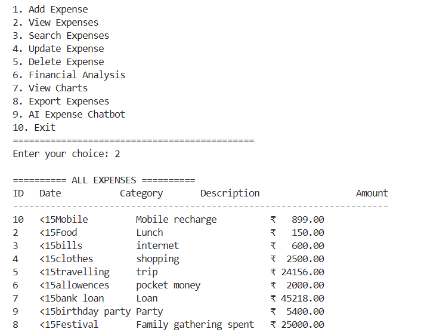

# Expense Tracker and Financial Analysis System

## Live Demo

Try the interactive Expense Tracker application here:

**Live App:** https://mamatha-expense-tracker.streamlit.app/

**GitHub Repository:** https://github.com/P-Mamatha0504/expense-tracker

## Project Overview

This is a Python-based Expense Tracker and Financial Analysis System that helps users manage daily expenses, analyze spending patterns, and understand their financial habits.

The application uses MySQL to store expense records and provides an interactive web dashboard built with Streamlit. It also includes an AI-powered chatbot using the Gemini API to answer expense-related questions.

## Features

- Add, view, edit, and delete expenses
- Store expense records in a MySQL database
- View expense records in an interactive table
- Analyze expenses by category and month
- Visualize spending patterns using interactive charts
- Export expense data
- Ask expense-related questions using the Gemini AI Expense Assistant
- Validate inputs and handle errors
- Access the application through a web browser

## Technologies Used

- Python
- Streamlit
- MySQL and SQL
- Pandas
- NumPy
- Matplotlib
- Plotly
- Gemini API
- OpenAI Python SDK
- Git and GitHub

## Project Structure

- `app.py` - Streamlit web application
- `main.py` - Main Python application
- `database.py` - Database connection and operations
- `expense.py` - Expense functionality
- `analysis.py` - Expense analysis
- `visualization.py` - Charts and visualizations
- `export.py` - Expense data export
- `chatbot.py` - Gemini AI chatbot
- `requirements.txt` - Required Python packages
- `screenshots/` - Project screenshots

## How to Run Locally

1. Install Python.
2. Install the required packages:

   `pip install -r requirements.txt`

3. Configure your MySQL database and connection settings.
4. Configure your Gemini API key securely.
5. Start the web application:

   `streamlit run app.py`

For the console version, run `python main.py` if you have configured its required database settings.

## Security

- Keep database passwords and API keys private.
- Store secrets in environment variables or Streamlit secrets.
- Do not commit passwords or API keys to GitHub.

## Screenshots

### Expense List

## Author

Pancheti Mamatha

## Project Links

- **Live Application:** https://mamatha-expense-tracker.streamlit.app/
- **GitHub Repository:** https://github.com/P-Mamatha0504/expense-tracker
